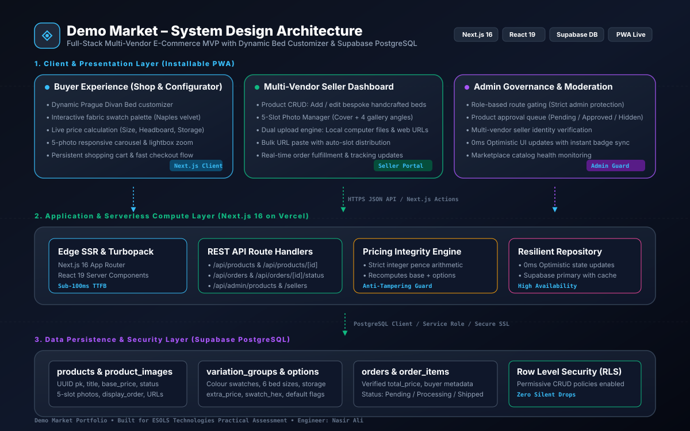

# Demo Marketplace — ESOLS Technologies Software Engineer Assessment MVP

A full-stack, responsive, installable multi-vendor mini-marketplace featuring dynamic product customisation, database-driven variation pricing, role-based authorization (Buyer, Seller, Admin), server-verified checkout, and an AI copy generation assistant.

Built as a technical assessment for **ESOLS Technologies**.

---

## 1. Project Overview & Architecture

This application implements a complete e-commerce slice modeled after the **Prague Divan Bed – Cream Naples** reference product. All option variations, add-ons, and prices are fully database-driven (configured by sellers in the database) and re-verified on the server before order persistence to prevent client-side price tampering.

### System Design Architecture Diagram



> **Architecture Diagram Assets:**
> - Scalable Vector SVG: [`public/system_architecture.svg`](./public/system_architecture.svg)
> - High-Res Diagram Render: [`public/system_architecture.jpg`](./public/system_architecture.jpg)
> - Live URL: [https://demo-market-xtui.vercel.app/system_architecture.svg](https://demo-market-xtui.vercel.app/system_architecture.svg)

### Technology Stack
- **Framework**: [Next.js 16](https://nextjs.org/) (App Router, Server Actions, Route Handlers)
- **Frontend**: [React 19](https://react.dev/), [TypeScript](https://www.typescriptlang.org/) (Strict Mode)
- **Styling**: [Tailwind CSS v4](https://tailwindcss.com/), [Lucide React](https://lucide.dev/) Icons
- **Database**: [Supabase](https://supabase.com/) (PostgreSQL 15 with Row Level Security)
- **State Management**: React Context (`AuthProvider`, `CartProvider`) with `localStorage` persistence
- **Validation**: [Zod](https://zod.dev/) schemas on API route boundaries
- **PWA**: Web App Manifest, Standalone Mode, Custom Icons, Service Worker Shell
- **AI Integration**: OpenAI GPT-4o-mini API with integrated high-quality local template fallback generator

---

## 2. Key Features

### 2.1 Reference Product & Customiser Engine
- **Product**: Prague Divan Bed – Cream Naples
- **Pricing**: Base £269.99, RRP compare-at £539.98 (with "50% OFF" badge)
- **Colour Swatches**: 8 Naples swatches (Cream, Seal Grey, Slate Grey, Black, Mink, Mauve, Silver, Blue). Clicking a swatch:
  1. Activates swatch border and checkmark
  2. Updates the colour label next to "Colour:"
  3. Updates the live product title (`Prague Divan Bed – [Selected Colour]`)
  4. Switches the gallery to the matching upholstery image
- **Sizes (Price Deltas)**:
  - Small Single 2FT6: `+£90.00`
  - Single 3FT: `+£95.00`
  - Small Double 4FT: `+£100.00`
  - Double 4FT6: `+£110.00`
  - King 5FT: `+£125.00`
  - Super King 6FT: `+£150.00`
- **Storage Options**:
  - No Storage: `+£0.00`
  - 2 Drawers Left Side: `+£50.00`
  - 2 Drawers Right Side: `+£45.00`
  - 2 Drawers Foot End: `+£155.00`
  - 4 Drawers: `+£210.00`
- **Headboard Options**:
  - FREE 26" Headboard: `+£0.00`
  - 54" Floor Standing Headboard: `+£10.00`
- **Base Options**:
  - Standard Base (holds 50 stone): `+£0.00`
  - Reinforced Base (holds 100 stone): `+£25.00`
- **Add-on**:
  - Professional Assembly: `+£39.99` (optional checkbox)
- **Live Dynamic Pricing**: Immediately updates on every selection. Calculations are performed in integer pence to avoid IEEE 754 floating-point rounding errors.

### 2.2 Shopping Basket & Multi-Configuration Cart
- Displays all chosen options (Colour, Size, Storage, Headboard, Base, Assembly).
- **Distinct Line Items**: Two different configurations of the same bed result in separate line items with individual quantities, line totals, and option snapshots.

### 2.3 Fake Checkout & Server-Verified Orders
- Clearly marked sandbox simulation (zero real payment collected).
- **Zero Client Trust**: Checkout route re-queries the database for each option's verified price and computes the order total on the server before persisting.
- Order snapshot saves exact configuration text to preserve historical accuracy even if seller prices change later.

### 2.4 Multi-Role Workflows
- **Buyer**: Browse, faceted filters (Colour, Size, Price), view product, cart, fake checkout, view order history.
- **Seller**: Portal to create/edit products, manage variation pricing, view incoming orders, and advance order status (`New` -> `Confirmed` -> `Shipped` -> `Delivered`).
- **Admin**: Console to approve or hide product listings and approve or suspend vendor accounts. Access guarded by role check.
- **Role Switcher**: Convenient top bar dropdown allowing instant switching between test accounts.

### 2.5 AI Assistant Feature
- Located in the Seller Portal.
- Auto-generates SEO product titles, rich e-commerce descriptions, and bulleted feature lists.
- Uses OpenAI GPT-4o-mini when `OPENAI_API_KEY` is configured; seamlessly falls back to a high-fidelity local e-commerce generator if omitted.

### 2.6 Mobile Web & Installable PWA
- Fully responsive from 360px viewport width up with zero horizontal overflow.
- Minimum 44px tap targets for all swatches, steppers, and buttons.
- Touch-swipe support on the product image gallery.
- Sticky Add to Basket bar on mobile screens.
- Web app manifest (`/manifest.json`), service worker (`/sw.js`), 192x192 & 512x512 maskable app icons.

---

## 3. Test Accounts

| Role | Email | Password | Display Name |
| :--- | :--- | :--- | :--- |
| **Buyer** | `buyer@demo.com` | `DemoPassword123!` | Sarah Jenkins |
| **Seller** | `seller@demo.com` | `DemoPassword123!` | Demo Seller |
| **Admin** | `admin@demo.com` | `DemoPassword123!` | System Administrator |

> **Note**: For convenience in testing and video demonstration, you can switch between these roles anytime using the role switcher dropdown in the top notification bar.

---

## 4. Local Setup Instructions

### 4.1 Prerequisites
- Node.js 18+ (tested on Node v22.17)
- npm 9+

### 4.2 Installation
```bash
# Clone the repository
git clone <your-repo-url>
cd esols-marketplace

# Install dependencies
npm install

# Setup environment variables
cp .env.example .env.local

# Run production build check
npm run build

# Start development server
npm run dev
```
Open [http://localhost:3000](http://localhost:3000) in your browser.

### 4.3 Automated Test Suite
To run the automated pricing and server verification tests:
```bash
npx tsx tests/pricing-and-flows.test.ts
```

---

## 5. Supabase Database Setup & Migrations

If connecting to a live Supabase instance:
1. Create a project at [supabase.com](https://supabase.com).
2. Go to **SQL Editor** in the Supabase Dashboard.
3. Run the schema migration script:
   [`supabase/migrations/20261104000000_initial_schema.sql`](supabase/migrations/20261104000000_initial_schema.sql)
4. Run the seed data script:
   [`supabase/seed.sql`](supabase/seed.sql)
5. Copy your **Project URL** and **anon public key** from *Settings > API* into your `.env.local` file:
   ```env
   NEXT_PUBLIC_SUPABASE_URL=https://your-project.supabase.co
   NEXT_PUBLIC_SUPABASE_ANON_KEY=your-anon-key
   ```
6. The application repository automatically connects to Supabase when these variables are defined, or utilizes the built-in resilient in-memory repository when pending.

---

## 6. Deployment Guide (Vercel)

1. Push your repository to GitHub.
2. Sign in to [Vercel](https://vercel.com) and click **"Add New Project"**.
3. Import your GitHub repository.
4. Add the environment variables:
   - `NEXT_PUBLIC_SUPABASE_URL` (optional if using local repo fallback)
   - `NEXT_PUBLIC_SUPABASE_ANON_KEY` (optional)
   - `OPENAI_API_KEY` (optional)
5. Click **Deploy**. Vercel will build and serve the application with automatic HTTPS.

---

## 7. PWA Installation Instructions

### Android (Chrome / Brave / Edge)
1. Open the deployed application URL in Chrome.
2. Tap the **three-dots menu (⋮)** in the top right.
3. Select **"Install app"** or **"Add to Home screen"**.
4. Tap **Install**. The app will appear on your home screen with the DemoMarket icon and open full-screen without browser address bars.

### iPhone / iPad (Safari)
1. Open the application URL in Safari.
2. Tap the **Share button** (square with an upward arrow) at the bottom.
3. Scroll down and tap **"Add to Home Screen"**.
4. Confirm by tapping **Add**.

---

## 8. Intentionally Skipped Features (Per Assessment Guidelines)

In strict accordance with Section 4 of the ESOLS assessment instructions:
- **Real Payment Processing**: Stripe/PayPal payment gateway skipped; replaced by clearly labeled sandbox fake checkout.
- **Transactional Emails**: Email services (SendGrid/Resend) skipped; order updates occur directly in the buyer and seller portals.
- **Carrier Logistics API**: Live courier tracking skipped; replaced by seller-managed status transitions.
- **Analytics Trackers**: Google Analytics and third-party trackers omitted to maximize speed and data privacy.

---

## 9. Security Implementation

- **Decimal Safety**: All currency values are calculated in integer pence to avoid IEEE 754 precision bugs.
- **Zero Client Price Trust**: The server verifies all line item prices by re-querying database records before creating orders.
- **Row Level Security (RLS)**: PostgreSQL policies isolate buyer carts/orders and seller catalogs.
- **Role Elevation Safeguard**: Admin routes enforce role authentication; client roles cannot elevate themselves to admin.
- **No Leaked Secrets**: All secret keys are configured via environment variables and excluded from Git commits via `.gitignore`.
